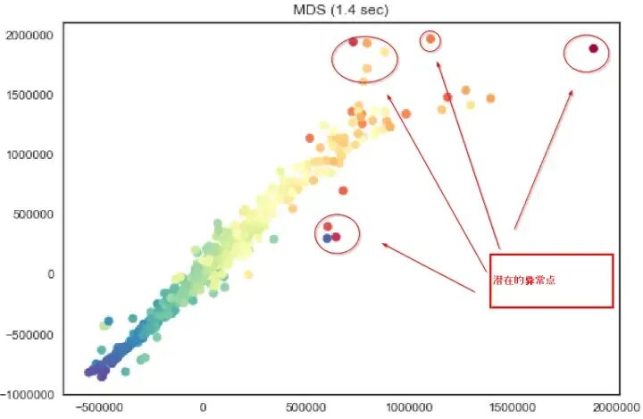
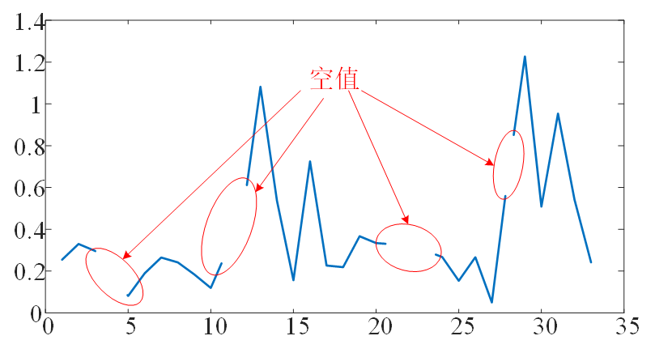
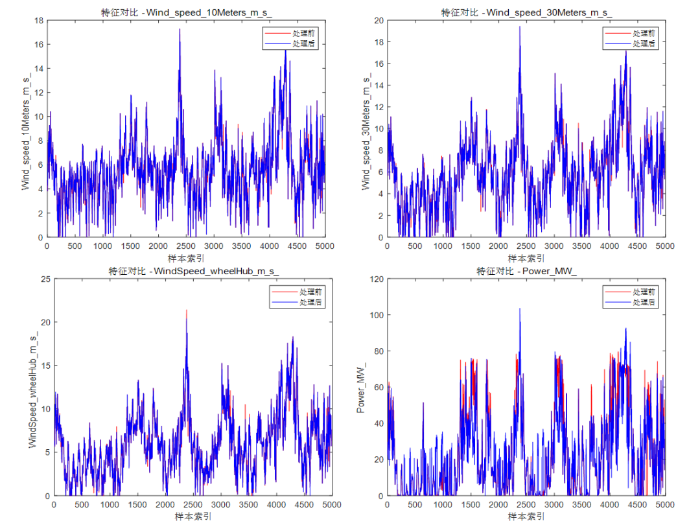
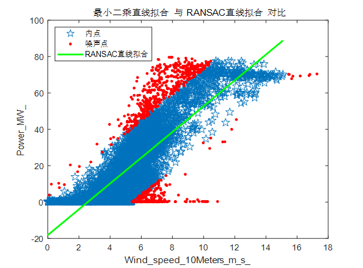
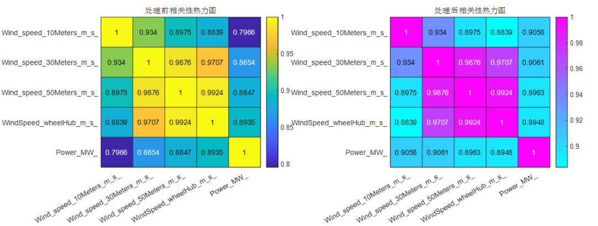

# Data Cleaning! Ready-to-use! Handling outliers, missing values, anomalies, residual analysis, and isolated forest anomaly detection to ensure the accuracy of data cleaning. MATLAB program

Applicable Platform: Matlab 2021 and above.
Data cleaning is a crucial step in data processing and analysis, especially for large and complex datasets like wind farms. The purpose of data cleaning is to ensure the accuracy, consistency, and completeness of the data, thereby improving the quality and reliability of data analysis. It is an important step before deep learning training and prediction.
In practical applications, data may contain outliers or noise due to sensor failures, communication errors, or human input mistakes. These outliers can severely affect subsequent data analysis and model training. Data cleaning ensures the accuracy of the data and reduces the interference of noise on the analysis results.
Missing values are common issues in datasets. If not handled, missing values can lead to inaccurate analysis results or model training failures. By filling in missing values, the integrity of the data can be improved, ensuring that each data point is meaningful.
①Outlier Detection and Handling:
Research Status:
Outlier detection and handling are important steps in data preprocessing. Common methods include statistical methods (such as Z-score, IQR), machine learning methods (such as Support Vector Machines), and deep learning methods (such as Autoencoder). Statistical methods use the statistical characteristics of the data (such as mean, variance, median) for outlier detection, suitable for simple datasets.
Method in this paper:
Combining statistical methods (deleting rows with identical elements) and robust fitting methods based on RANSAC, effectively handling various types of outliers.
RANSAC method can perform reliable model fitting even in the presence of noise and outliers, suitable for datasets with significant outliers.
②Missing Value Handling:
Research Status:
There are many methods for missing value handling, including deletion, imputation (such as mean imputation, median imputation, nearest neighbor imputation), interpolation (such as linear interpolation, spline interpolation), and model prediction (such as multiple imputation, matrix factorization).
Simple imputation methods (such as mean imputation) are easy to implement but may introduce bias.
③ Interpolation method utilizes data continuity for filling, suitable for time series data.
④ Model prediction method uses machine learning models to predict missing values, with high accuracy but complex computation.
This paper's method:
Forward imputation is simple and effective, suitable for time series data, capable of preserving the trend and pattern of the data.
Forward imputation has low computational cost, suitable for rapid processing on large-scale datasets.
③ Outlier handling
Research status:
① Outlier detection methods include statistical-based detection methods (such as Grubbs' Test, Tukey's Fences), clustering-based methods (such as K-means, DBSCAN), and machine learning-based methods (such as Isolation Forest, LOF).
② Statistical methods are suitable for simple datasets and easy to implement.
③ Clustering methods identify outliers by analyzing the density or distance of data points, suitable for datasets with clear clusters.
④ Machine learning methods can handle complex data distributions and high-dimensional data, with high detection accuracy.
This paper's method:
Combining moving window statistical characteristics (moving window linear interpolation) and residual outlier detection methods (Isolation Forest), robust against outliers.
Using median absolute deviation (MAD) method for moving window linear interpolation smoothes data fluctuations, suitable for time series data.
Residual analysis combined with Isolation Forest effectively identifies outliers in complex data distributions.
④ Innovation summary
Multiple methods combined, comprehensive treatment:
By removing rows with identical elements, forward imputation of missing values, moving window linear interpolation, and RANSAC fitting, ensure comprehensiveness and robustness of data processing.
Efficient computation, wide applicability:
Simple and effective forward imputation and moving window linear interpolation methods, with low computational cost, suitable for rapid processing on large-scale datasets.
RANSAC fitting and Isolation Forest methods are suitable for complex data distributions, capable of handling high-dimensional data and noisy data.
Visualization display, intuitive evaluation:
By visualizing the correlation heatmaps and feature comparison diagrams before and after processing, we can intuitively demonstrate the effectiveness of data handling. This facilitates evaluation and verification of the method's efficacy. 
Visualization aids in understanding data characteristics and changes, enhancing the transparency and interpretability of data processing. 
Program results: 
Data comparison between pre- and post-processing for various feature variables: 
Some program: 
Stay tuned for high-innovation, high-quality learning materials, articles, and code updates to fuel your research endeavors!

## Images

<!-- PAYMENT_BLOCK -->

## Get this dataset

- Payment link (Stripe): [Buy now](https://buy.stripe.com/3cs8yP7sY87d0vu9AB)
- Payment QR code: 

<!-- /PAYMENT_BLOCK -->
